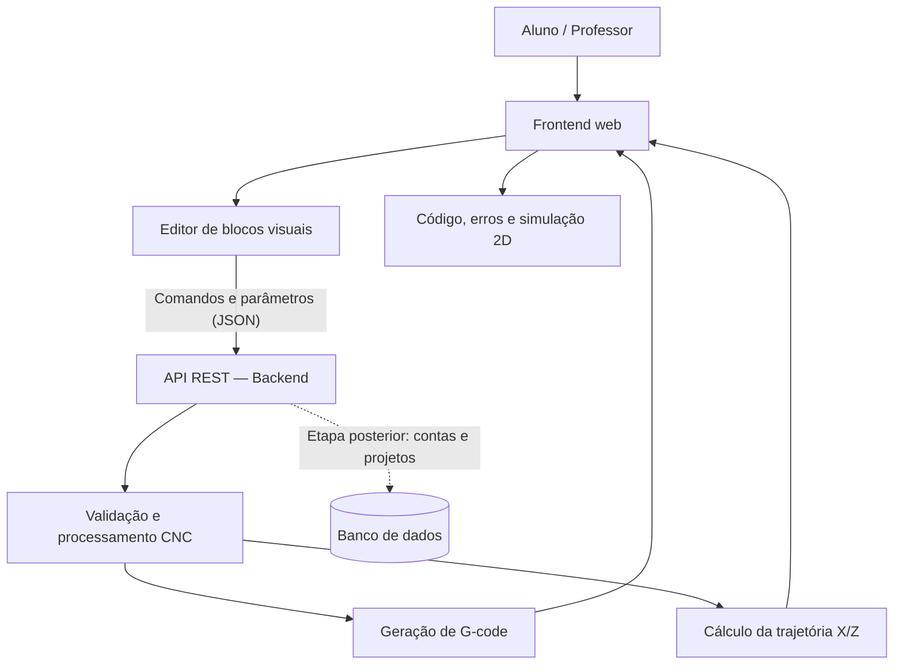

# EasyG

### Programação CNC de um jeito mais visual, interativo e acessível.

O **EasyG** é um projeto de plataforma web educacional que busca facilitar os primeiros passos na **programação de tornos CNC**. Por meio de um editor de **blocos visuais**, o estudante poderá construir sequências de comandos, acompanhar a geração de **G-code** e visualizar a trajetória simulada da ferramenta em um plano **2D (eixos X e Z)**.

> **Status:** em desenvolvimento. As funcionalidades descritas representam o escopo planejado, não recursos já disponíveis em produção.

## Sobre o projeto

Aprender G-code exige compreender comandos, parâmetros, coordenadas e como cada instrução afeta o movimento de uma ferramenta. Para quem está começando, relacionar linhas de código com uma trajetória pode ser desafiador.

O EasyG pretende aproximar esses conceitos com uma experiência prática: em vez de escrever o programa inteiro manualmente, o usuário organiza blocos de comandos CNC, ajusta seus parâmetros e acompanha o resultado de maneira visual.

**Público-alvo:** estudantes e aprendizes de programação CNC, além de professores e instrutores que desejam apoiar suas explicações com simulações interativas.

## Como o EasyG deverá funcionar

1. **Montar o programa:** escolher comandos em uma biblioteca de blocos e organizá-los na sequência desejada.
2. **Configurar os parâmetros:** informar coordenadas e demais valores exigidos por cada comando.
3. **Gerar o G-code:** visualizar automaticamente as instruções correspondentes, respeitando a ordem dos blocos.
4. **Validar a programação:** receber mensagens explicativas sobre parâmetros ausentes, valores inválidos e outros erros de programação.
5. **Visualizar a trajetória:** acompanhar, em um gráfico 2D nos eixos X e Z, os movimentos calculados a partir do programa.
6. **Executar a simulação:** iniciar, pausar, continuar, reiniciar ou avançar passo a passo, identificando o comando e a posição atual da ferramenta.

A proposta é manter **blocos, G-code, validações e gráfico sincronizados** conforme o usuário modifica a programação.

## Funcionalidades planejadas

| Área | O que está previsto |
| --- | --- |
| **Editor visual** | Seleção, adição, edição, organização e remoção de blocos CNC. |
| **Biblioteca de comandos** | Catálogo de comandos suportados com explicações e parâmetros. |
| **Geração de G-code** | Tradução dos blocos para instruções na ordem programada. |
| **Validação** | Identificação de erros por bloco, com feedback compreensível e bloqueio de simulações inválidas. |
| **Simulação 2D** | Desenho da trajetória nos eixos X/Z e diferenciação dos tipos de movimento. |
| **Controles interativos** | Execução contínua e passo a passo, pausa, retomada, reinício, zoom e deslocamento do gráfico. |
| **Acompanhamento** | Destaque do bloco em execução, da linha correspondente de G-code e das coordenadas atuais. |
| **Apoio ao aprendizado** | Exemplos, consulta aos comandos e orientações de utilização. |

### Comandos previstos para o escopo inicial

| Comandos | Finalidade |
| --- | --- |
| `G00`, `G01` | Movimentação rápida e interpolação linear. |
| `G02`, `G03` | Interpolação circular. |
| `G04` | Pausa temporizada. |
| `G18` | Seleção do plano XZ. |
| `G20`, `G21` | Definição das unidades de medida. |
| `G90`, `G91` | Programação absoluta ou incremental. |
| `G94` | Modo de avanço por minuto. |
| `M30` | Encerramento do programa. |

O EasyG trabalhará com um **subconjunto controlado de G-code**, sem a pretensão de interpretar todos os comandos existentes em máquinas CNC.

## Arquitetura prevista

A solução será organizada em **frontend e backend independentes**, com comunicação por **API REST**:

### Tecnologias previstas

- **Frontend:** HTML, CSS, JavaScript e Google Blockly para a programação visual por blocos.
- **Backend:** Java e Spring Boot, seguindo uma organização em camadas e disponibilizando endpoints REST.
- **Persistência (etapa posterior):** Spring Data JPA e banco de dados relacional, com modelo SQL inicial documentado em MySQL.
- **Colaboração e versionamento:** Git, GitHub, issues, pull requests e Conventional Commits.

As decisões de implementação poderão ser refinadas conforme a evolução do projeto.

## Organização dos repositórios

| Repositório | Objetivo |
| --- | --- |
| [**easyg-frontend**](https://github.com/simulador-easyG/easyg-frontend) | Interface, editor de blocos e visualização da simulação. |
| [**easyg-backend**](https://github.com/simulador-easyG/easyg-backend) | Validação, interpretação dos comandos, geração de G-code e cálculo de trajetórias. |
| [**easyg-docs**](https://github.com/simulador-easyG/easyg-docs) | Documentação do projeto, requisitos, arquitetura e procedimentos operacionais. |
| [**.github**](https://github.com/simulador-easyG/.github) | Apresentação da organização e arquivos de comunidade. |

> **Nota:** alguns repositórios são privados e exigem acesso de integrante da equipe. Os repositórios de implementação ainda não possuem código publicado.

## Evolução do projeto

**Primeira versão (MVP)**

- [ ] Criar e editar programas usando blocos visuais.
- [ ] Gerar e visualizar o G-code correspondente.
- [ ] Validar comandos e parâmetros com retorno de erros.
- [ ] Calcular e exibir trajetórias 2D nos eixos X/Z.
- [ ] Oferecer controles da simulação e recursos educacionais.

**Etapa posterior — contas e projetos**

- [ ] Cadastrar e autenticar usuários.
- [ ] Salvar projetos associados à conta.
- [ ] Listar, abrir, atualizar e excluir projetos próprios.
- [ ] Avisar sobre alterações ainda não salvas.

O editor deverá permitir uso por visitantes; o armazenamento permanente de projetos será uma funcionalidade específica da etapa posterior, com autenticação e salvamento explícito.

## Limites da simulação

O EasyG tem finalidade **exclusivamente educacional**. O projeto:

- **Não** comanda ou se conecta a máquinas CNC reais.
- **Não** realiza usinagem física ou simulação tridimensional.
- **Não** substitui simuladores industriais, normas de segurança ou a conferência de programas antes de sua utilização em equipamentos reais.
- **Não** garante a ausência de colisões ou a segurança de uma operação de usinagem.

## Documentação e desenvolvimento

A equipe mantém no repositório [easyg-docs](https://github.com/simulador-easyG/easyg-docs) o documento de visão, as histórias de usuário, as regras de negócio, os diagramas de arquitetura, o modelo de dados e os Procedimentos Operacionais Padrão (POPs).

O planejamento e as entregas são acompanhados por **issues**, com revisão de alterações por meio de **pull requests** e registro das decisões técnicas.

## Projeto Integrador

O EasyG é desenvolvido como **Projeto Integrador do curso Técnico de Informática para a Internet do SENAI/CentroWEG**, em Jaraguá do Sul, Santa Catarina, no ano de **2026**.

**Equipe:** Igor Negherbon Heiser, Gustavo Richardt, Renan de Bitencourt Daboit, Nicolas Madruga Souza e Arthur Miguel Schlichting.

**Orientação:** Prof. Carlos.

---

**EasyG — transforme blocos em código e código em aprendizado.**
